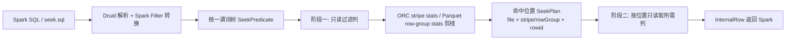

# spark-filter-seek

Spark SQL 自定义数据源（DataSource V2），读取 ORC / Parquet 时做**两阶段取数**：

1. **阶段一（Seek）**：只读过滤字段，用文件内统计信息剪枝 stripe / row group，返回命中行的
   `文件 + 块位置 + rowid`。
2. **阶段二（Fetch）**：只回到命中的位置，读取 SELECT 真正需要的列，跳过无关行。

目标是在过滤选择率低（例如千万行里命中几百行）且存储位于远端（S3 / OSS / HDFS）时，
显著减少网络传输的数据量。过滤条件既支持 Spark SQL 下推，也支持用 **Alibaba Druid**
直接解析一条 SQL 的 WHERE 子句。

---

## 1. 链路设计



阶段一每个 Spark task 处理一个文件，因此剪枝和扫描都在 executor 并行执行，driver 只做文件枚举。

位置模型：

| 格式 | 块 | 行位置 | Seek 返回示例 |
|---|---|---|---|
| ORC | stripe 序号 | stripe 内行号 + 文件内全局 rowid | `file=/data/a.orc, stripe=3, row=217, rid=3217` |
| Parquet | row group 序号 | row group 内行号 + 文件内全局 rowid | `file=/data/b.parquet, rowGroup=1, row=88, rid=11288` |

ORC 阶段二通过 `RecordReader.seekToRow(globalRowId)` 直接定位；Parquet 阶段二只打开含命中行的 row group。

---

## 2. 支持的过滤方式

- 比较：`=`、`!=` / `<>`、`>`、`>=`、`<`、`<=`
- 集合：`IN (...)`、`NOT IN (...)`
- 字符串：`LIKE 'abc%'`（`%` / `_` 通配符）、`NOT LIKE`
- 逻辑：`AND` / `OR` / `NOT`
- 行数：`LIMIT N`（可选，配置 Redis 后下推到扫描阶段，多分区共享一个全局计数器；详见第 6 节）

不支持的表达式（函数、算术、子查询、嵌套字段等）**不会**被吞掉：数据源会把它们返回给 Spark
重新计算，保证结果正确。阶段一的统计剪枝是保守的，宁可多读块也不会漏掉命中行。

---

## 3. 快速开始

### 3.1 构建

```bash
mvn -q package
# Druid 不在 Spark 中，单独取 jar 随任务提交
mvn -q dependency:copy -Dartifact=com.alibaba:druid:1.2.23 -DoutputDirectory=target
```

产物：

- `target/spark-filter-seek-1.0.0-SNAPSHOT.jar` — 本项目代码 **+ Redisson 及其全部依赖**（已 shade 并重定位）
- `target/druid-1.2.23.jar` — Druid 依赖（唯一需要额外提交的 jar）

**Redisson 已经打进主 jar，无需再带任何 Redis/Netty 客户端 jar。** shade 时对 netty / jackson / reactor / rxjava 等依赖做了包名重定位（前缀 `org.redisson.shaded.*`），因此与 Spark 自带的同名库完全隔离，不会产生类加载冲突；slf4j 日志门面共享 Spark 的。

Spark / Hadoop / ORC / Parquet 均标记为 `provided`，由 Spark 运行时提供，不打进 jar；Druid 也不打进 jar。
当前版本基于 **Spark 3.3.4 / Scala 2.12 / Hadoop 3.3.4 / ORC 1.9.2 / Parquet 1.13.1 / Druid 1.2.23 / Redisson 3.16.3**。切换 Spark 小版本只需改 `pom.xml` 的 `spark.version`。
构建产物为 **Java 8 字节码（major 52）**，可在 JDK 8/11/17 上运行。JDK 8 下直接用 source/target 1.8 构建；JDK 9+ 构建时自动切到 release 8，并仅在测试阶段加 `--add-opens`。JDK 25 因 Hadoop UGI 兼容问题不建议。

### 3.2 用 Spark SQL 下推过滤

```scala
val df = spark.read.format("filter-seek")
  .option("path", "s3://bucket/warehouse/fact/")   // 也支持 paths = JSON 数组
  .option("format", "orc")                        // 可省略，按扩展名推断
  .load()

df.createOrReplaceTempView("fact")

spark.sql("""
  SELECT id, region, amount
  FROM fact
  WHERE region = 'CN'
    AND amount >= 100
    AND status IN ('PAID', 'NEW')
""").show()
```

### 3.3 用 Druid 直接解析 SQL

当上层是网关 / 服务，拿到的是完整 SQL 而不是 Spark 计划时，可以把 SQL 通过 `seek.sql` 传入：

```scala
val sql = "SELECT * FROM fact WHERE region LIKE 'C%' AND amount >= 100"

val df = spark.read.format("filter-seek")
  .option("path", "s3://bucket/warehouse/fact/")
  .option("seek.sql", sql)
  .load()

df.count()
```

`seek.sql` 解析出的谓词与 Spark 下推的谓词会做 **AND** 合并，不会互相覆盖。

### 3.4 提交作业

```bash
spark-submit \
  --jars target/spark-filter-seek-1.0.0-SNAPSHOT.jar,target/druid-1.2.23.jar \
  --conf spark.sql.extensions= \
  your-app.jar
```

### 3.5 运行自带示例

```bash
# JDK 8 直接构建即可，无需任何额外 JVM 参数
JAVA_HOME=<JDK 8> mvn -q clean package

# 也可以用 JDK 11/17 构建，产物仍是 Java 8 字节码
JAVA_HOME=<JDK 17> mvn -q clean package
```

示例会生成 400 行样例数据，分别写 ORC / Parquet，然后验证三条查询链路。当前结果：

```
ORC  Spark-pushdown filter hits : 64 (expected 64)
Parquet LIKE filter hits        : 95 (expected 95)
Druid seek.sql filter hits      : 108 (expected 108)
SparkConf ignoreCase hits       : 44 (expected 44)
Option ignoreCase=false hits    : 0 (expected 0)
lower() with ignoreCase=false   : 44 (expected 44)
```

---

## 4. 配置项

| 参数 | 默认值 | 说明 |
|---|---|---|
| `path` / `paths` | 必填 | 文件路径、目录或 glob；`paths` 为 JSON 数组 |
| `format` | 按扩展名推断 | `orc` 或 `parquet` |
| `seek.sql` | 空 | 用 Druid 解析 WHERE 子句 |
| `seek.dumpPlan` | `false` | 在 executor 日志打印每个块的命中行位置样例 |
| `seek.ignoreCase` | 取 SparkConf，默认 `true` | 字符串比较是否忽略大小写；优先级高于 SparkConf |
| `seek.redis.address` | 无 | Redis 地址，如 `redis://127.0.0.1:6379`；配置后才启用 LIMIT 下推 |
| `seek.redis.password` | 空 | Redis 密码 |
| `seek.redis.database` | `0` | Redis 数据库编号 |
| `seek.redis.batch` | `1000` | 每个 task 每次向 Redis 领取的额度条数 |
| `seek.redis.key` | 每次查询自动生成 | 全局计数器的 key；不指定则按查询 UUID 生成，避免并发查询互相干扰 |
| `seek.redis.ttlSeconds` | `3600` | 计数器 key 的 TTL，防止查询异常取消后 key 泄漏 |
| `seek.redis.poolSize` | `8` | 单个 executor JVM 内 Redisson 连接池上限 |
| `hadoop.*` | 无 | 以 `hadoop.` 开头的参数会去掉前缀后写入 Hadoop Configuration |

会话级开关（可用 `spark-submit --conf` 或 `spark.conf.set`）：

```bash
spark-submit --conf spark.filterseek.ignoreCase=false ...
```

说明：

- 默认忽略大小写，因此 `lower(name) = '11'` 这类写法可以正常下推；`lower` / `upper` /
  `lcase` / `ucase` 包裹的列会被解包，并强制该叶子谓词忽略大小写（即使全局开关为 `false`）。
- 其他函数（如 `substring(name,1,1)`）不会静默忽略，会显式报错，剩余条件可交给 Spark 重算。

---

## 5. 调优与监控

### 5.1 调优要点

| 项目 | 建议 | 验证方法 |
|---|---|---|
| ORC stripe 大小 | 过滤选择率低时减小 stripe（如 8~64MB），提高剪枝粒度 | 看 `Phase-1 seek plan` 中 `pruned / blocks` |
| Parquet row group | 用 `parquet.block.size` 控制，过小会增加 footer 开销 | 对比 `rowsScanned` 与原表行数 |
| 过滤字段数 | 只把真正用于过滤的列放在 WHERE 里，阶段一只读这些列 | 观察远端读字节量 |
| IN 大列表 | 阶段一每个分区只构建一次 HashSet，每行 O(1) 判定；几百个值也可直接下推 | 对比 IN 值数量翻倍前后的 `rowsScanned` 与耗时 |
| LIKE 大批量 | 正则每个分区只编译一次，不再逐行 `Pattern.compile` | 看 executor 火焰图中正则编译占比 |
| SELECT 列数 | 列裁剪越窄，阶段二带宽越省 | 对比全列读取的 bytes read |
| 统计信息 | ORC/Parquet 写入时确保开启 column statistics | `describe` / 元数据里检查 min/max |
| 无过滤查询 | 没有可下推谓词时退化为普通列裁剪扫描 | 日志出现 `No pushed predicate` |

参数层面的预期收益：阶段一传输量约等于 `过滤列大小 × 参与块行数`，阶段二约等于
`所需列大小 × 命中行数`；相比整表全列扫描，节省比例近似 `1 - (阶段一+阶段二)/全表全列`。

### 5.2 监控指标

每次阶段一都会输出一行日志：

```
SeekPlan{orc /data/a.orc, blocks=12, pruned=9, rowsScanned=30000, hits=127}
```

建议采集并告警：

- `blocksPruned / blocksTotal`：剪枝率，持续为 0 说明统计信息缺失或谓词无法剪枝
- `rowsScanned`：阶段一扫描行数，突增说明过滤条件下推失败
- `hitCount`：命中行数，与上游业务预期对比可做数据质量校验
- 任务级 bytes read：验证带宽是否真的下降

### 5.3 数据质量

- 空值语义与 SQL 一致：比较 / IN / LIKE 遇到 NULL 返回 false，不会被误命中。
- 上线前用同一 SQL 分别跑原生 `orc` / `parquet` 数据源与 `seek` 数据源，对 `count` 和主键集合做一致性校验。
- **不覆盖式重跑生产数据**：重建索引或修数据先写影子表，校验通过后再切换。
- 涉及个人信息字段时，在 SELECT 侧做脱敏并控制目录权限；`seek.sql` 中的字面量会进入日志，敏感值需避免明文传入。

---

## 5.2 用 Redis 做全局 LIMIT 控制

不配置 Redis 时，`LIMIT` 由 Spark 自己的 `GlobalLimit` 在 scan 之后处理，扫描层不做提前终止。
配置 Redis 地址后，`LIMIT N` 会下推到扫描层，所有分区共享一个 Redis 原子计数器：

```scala
spark.conf.set("spark.filterseek.redis.address", "redis://redis-host:6379")
spark.conf.set("spark.filterseek.redis.password", "xxx")   // 可选

val df = spark.read.format("filter-seek")
  .option("path", "s3://bucket/warehouse/fact/")
  .load()

spark.sql("SELECT * FROM t WHERE amount > 100 LIMIT 10000").show()
```

工作原理：

1. **driver** 在 build scan 时为本次查询生成唯一的 Redis key，把计数器初始化为 0 并设 TTL。
2. **每个 task** 从 Redis 批量领取额度：一次 `INCRBY batch` 拿到一段连续的全局序号区间，
   超出全局 `LIMIT N` 的部分会被裁剪，因此所有 task 发出的行总数**精确不超过 N**。
3. 本地额度用完才再次访问 Redis。`batch=1000`、`LIMIT=100000` 时整个查询只有约 100 次
   Redis 往返，与实际扫描行数无关。
4. **连接数控制**：Redisson 客户端按连接参数在 executor JVM 内做进程级单例缓存，
   所有 task 共享同一个连接池；`seek.redis.poolSize` 限制每个客户端的连接上限。
   不会出现"每 task 一个客户端"的连接爆炸。

注意：

- Redisson 及其依赖（含 Netty）已 shade 进主 jar 并做了包名重定位，无需随任务单独提交；只有 Druid 仍需单独带 jar（见 3.1 构建）。
- 配额块是"先占后用"，task 结束时未用完的额度只在本地归还，不回写 Redis，
  因此极端情况下（大量 task 各自只领不用）实际返回可能略少于 N，但绝不会超过 N。
- 计数器 key 默认每次查询自动生成，避免并发查询互相重置；若需跨查询共享配额可显式设置 `seek.redis.key`。

---

## 6. 限制

1. 只支持顶层基本类型字段（数值、字符串、布尔、日期、时间戳、小数）；嵌套 struct/list/map 会显式报错。
2. Parquet 的 INT96 时间戳不支持，请使用 TIMESTAMP_MILLIS / TIMESTAMP_MICROS。
3. `LIKE` 只在前缀模式（如 `abc%`）下做统计剪枝，其他模式仍会精确求值，只是少剪枝。
4. `NOT` / `NOT LIKE` 不做统计剪枝（保证不误删），但求值精确。
5. Parquet 阶段二会遍历含命中行的整个 row group 的列值（只读所需列），未实现行级 `skip()`；
   如 row group 很大，可调小 `parquet.block.size`。
6. Druid 解析只接受简单 `SELECT ... FROM ... WHERE ...`；列上仅允许 `lower` / `upper` / `lcase` / `ucase` 包裹，复杂 JOIN / 子查询 / 其他函数请交给 Spark 下推 Filter。
7. 无谓词时退化为普通列裁剪扫描，不做位置索引。

---

## 7. 代码结构

```
src/main/java/com/example/spark/seek/
├── SeekDataSourceProvider.java        # TableProvider / DataSourceRegister 入口
├── demo/SeekDemo.java                  # 端到端示例
├── predicate/                          # 统一谓词树、求值、统计剪枝
├── sql/DruidSqlParser.java             # Druid SQL -> SeekPredicate
├── spark/                              # ScanBuilder / Scan / Partition / Reader
├── seek/                               # SeekPlan、ORC/Parquet 阶段一、值转换
├── reader/                             # ORC/Parquet 阶段二 RowFetcher
└── util/                               # Schema、配置、InternalRow 转换
```
